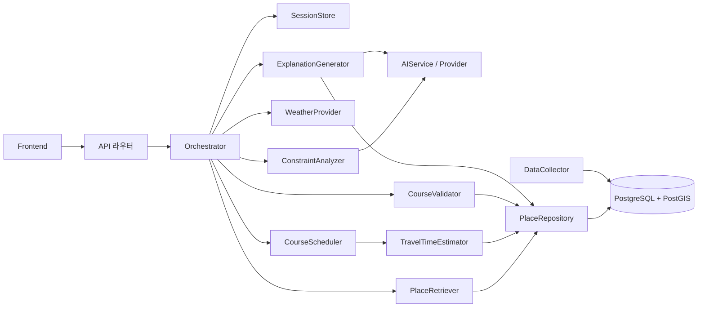

# 원본 컴포넌트와 구현 위치

기준: SDD 2~3장 및 내장 아키텍처·서비스 클래스 도식. 파일명은 구현 배치안이고 원본이 요구한 정확한 폴더명은 아니다. 업무 기능은 모두 미구현이며 API 오류 처리 골격만 존재한다.

| ID | 원본 책임 | 담당 | 위치 |
|---|---|---|---|
| COMP-01 | Frontend | 배진호 | frontend/ |
| COMP-02 | API Gateway / Orchestrator·SessionStore | 김영무 | backend/app/api/, application/, sessions/ |
| COMP-03 | ConstraintAnalyzer | 김영무 | backend/app/constraints/ |
| COMP-04 | PlaceRetriever | 이찬용 | backend/app/retrieval/ |
| COMP-05 | CourseScheduler | 김영무 | backend/app/courses/ (scheduler 예정) |
| COMP-06 | TravelTimeEstimator | 이찬용 | backend/app/travel/ |
| COMP-07 | CourseValidator | 김영무 | backend/app/courses/ (validator 예정) |
| COMP-08 | ExplanationGenerator | 김영무 | backend/app/explanations/ |
| COMP-09 | AIService·Provider | 김영무 | backend/app/ai/ |
| COMP-10 | PlaceRepository | 이찬용 | backend/app/data/ |
| COMP-11 | DataCollector | 이찬용 | pipelines/ |
| COMP-12 | WeatherProvider | 이찬용 | backend/app/weather/ |

PM 김세민은 문서·일정·평가·검수·발표를 총괄하고 와이어프레임·프롬프트 작성을 보조한다(계획서 9장). 담당 변경은 없다.

## 호출 흐름

API는 입출력·오류를 처리하고 application이 실행 순서·실패·세션 일관성을 제어한다. constraints/retrieval/courses/travel/explanations는 업무 규칙, ai/data/weather는 외부 연결 책임이다. domain은 공유 업무 모델, API JSON 모델은 api에 둔다. 파일에서 계층을 구분하며 별도 서비스로 배포하지 않는다.
원본 도식마다 날씨 조회와 검색 순서가 조금 다르므로, 날씨 HARD 조건을 사용하는 경우 최종 후보 선정·검증 전에 반영되도록 구현 시 명시한다. LLM은 장소 선택·시간 계산을 하지 않는다.

## 전체 범위의 위치
- 앵커·부분 수정·제안 생성: courses + application + constraints, FR-010·013~015. adjust 계약은 후속 정의.
- 편의시설: data의 시설 조회 + api 라우터 + frontend UI-05, FR-017. 별도 마이크로서비스 불필요.
- 공유: application/api + data 저장 + frontend UI-06, FR-019 Could. 민감 항목 제거·만료 정책 검토 후 착수.
- 수집: pipelines, SDD API-010은 `python -m batch.collect --source all` 예시. 현재 실행 가능 명령이 아니며 패키지 경로는 구현 시 문서와 함께 맞춘다.
- 배포: deployment/, SDD 10장 초안의 단일 VM·Docker Compose·nginx/API/DB/batch 배치. 아직 배포 파일 없음.

## API 추적
| SDD ID | 경로/작업 | 현 계약 |
|---|---|---|
| API-001 | POST /api/sessions | 포함, 미구현 |
| API-002 | POST /api/chat | 포함, 미구현 |
| API-003 | PUT /api/sessions/{id}/profile | {sessionId}로 명확화, 포함·미구현 |
| API-004 | POST /api/courses | 포함, 미구현 |
| API-005 | POST /api/courses/{courseId}/adjust | 후속 계약 |
| API-006 | GET /api/places/{placeId} | 포함, 미구현 |
| API-007 | GET /api/facilities | 후속 계약 |
| API-008 | POST /api/courses/{courseId}/share | 후속 계약 |
| API-009 | GET /api/share/{shareId} | 후속 계약 |
| API-010 | 관리자 배치 CLI | 미구현, HTTP 미노출 |
