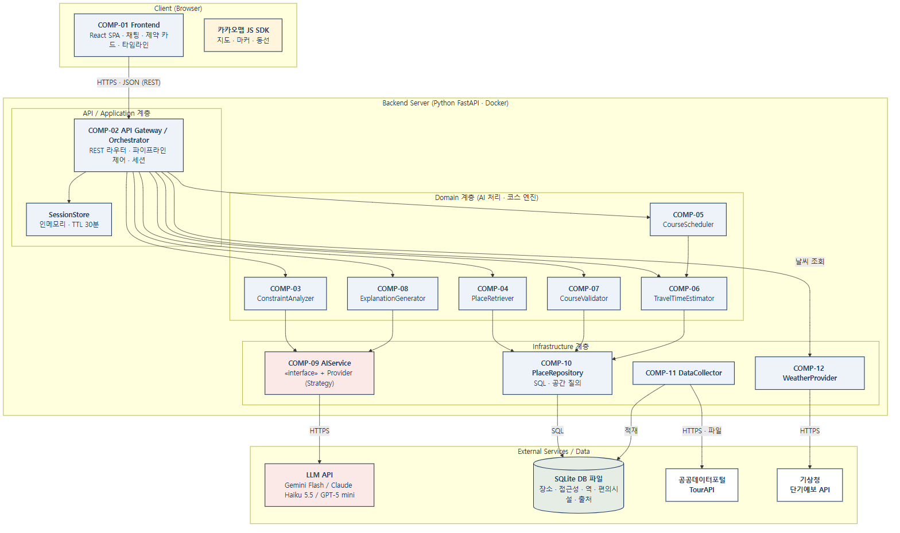
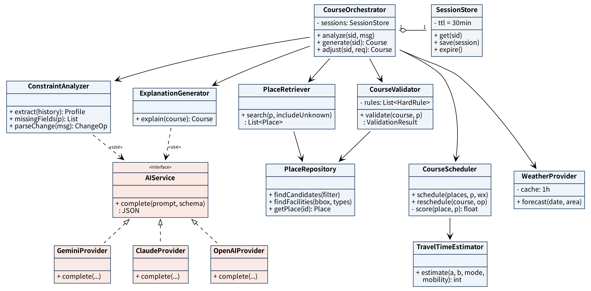
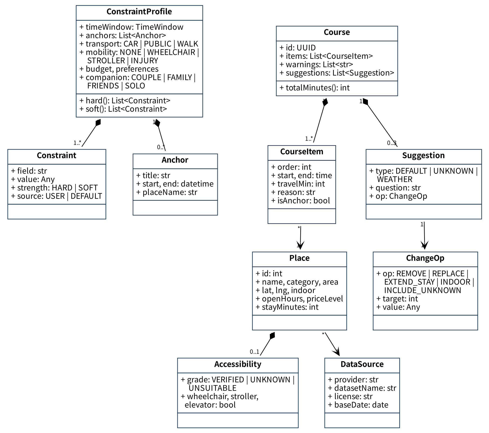
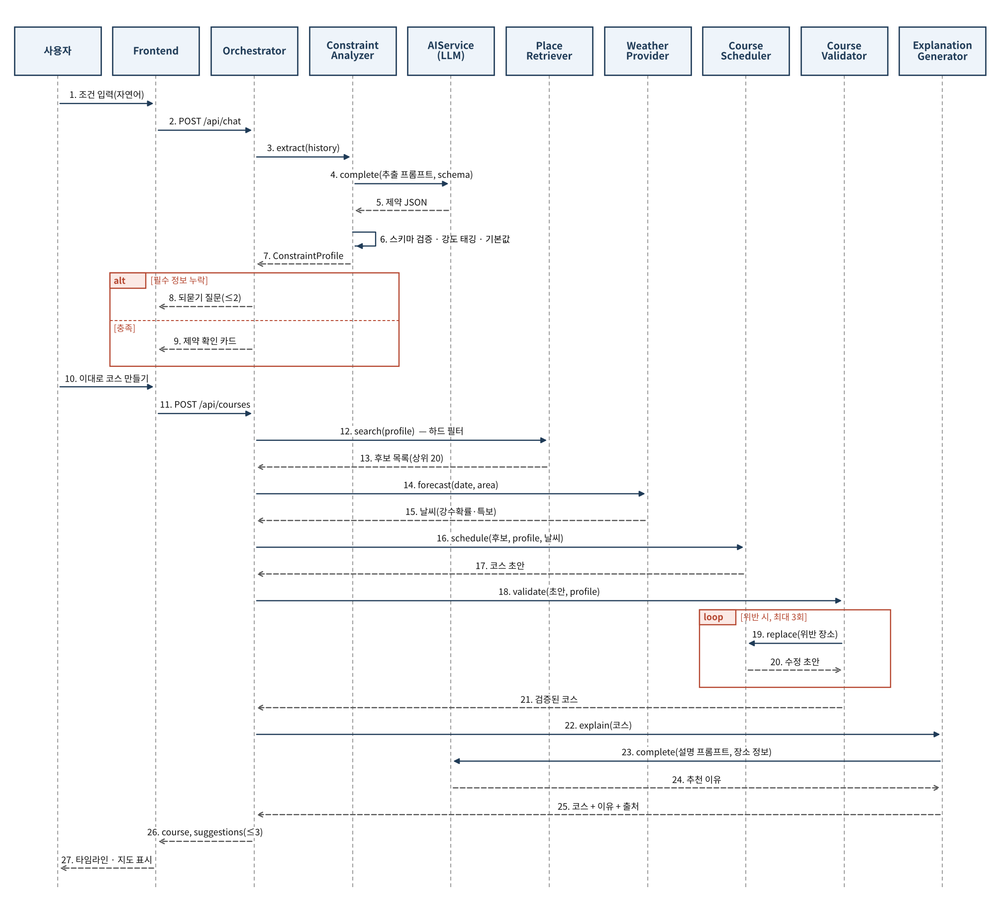
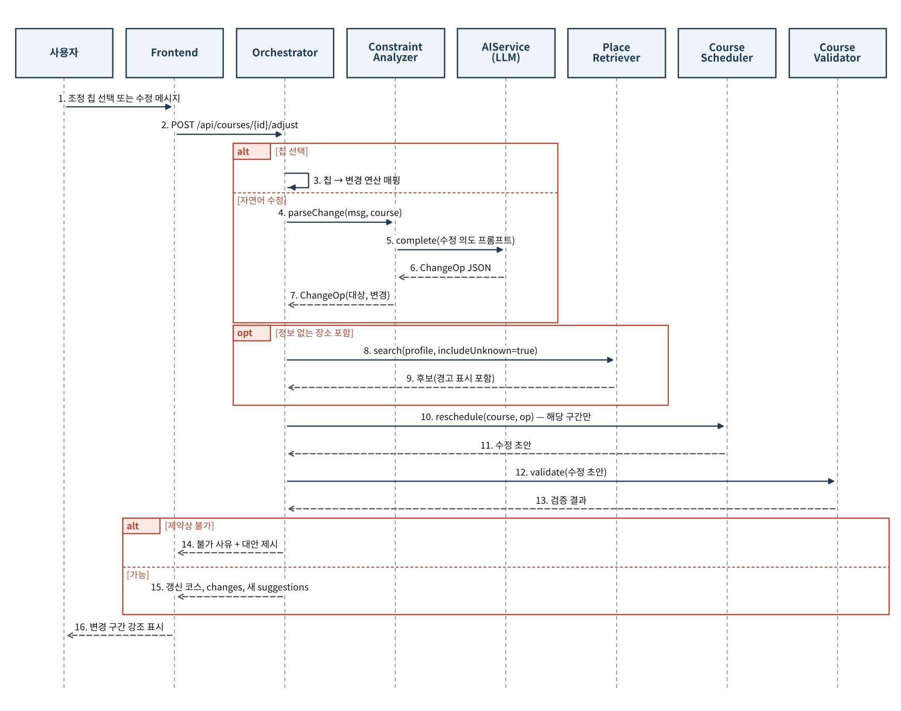
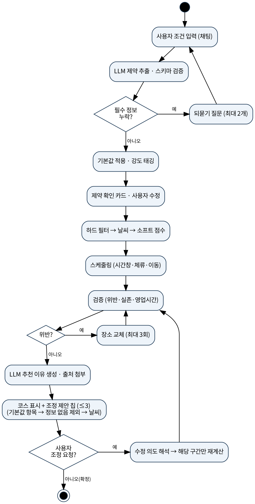
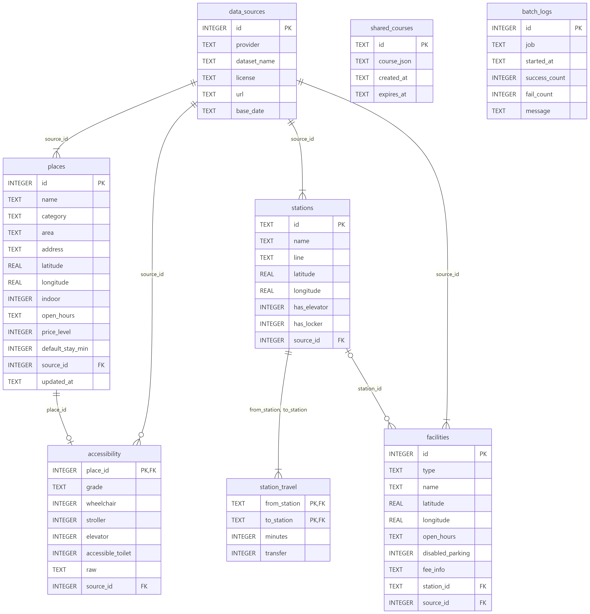
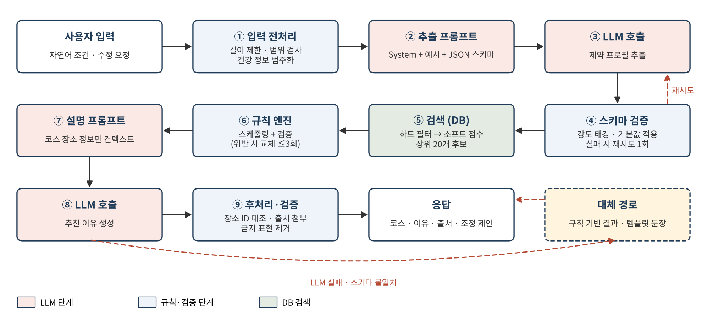
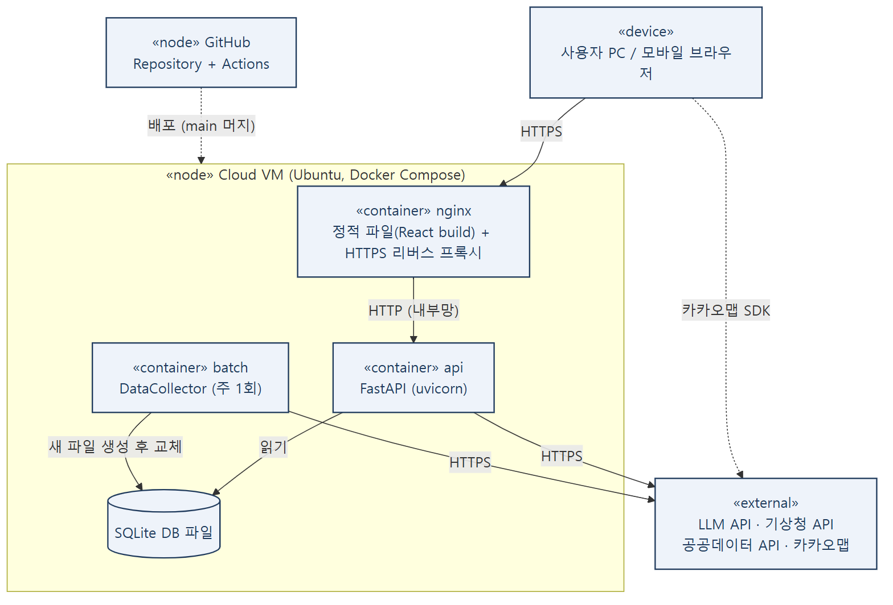

**소프트웨어 설계 명세서**

Software Design Document (SDD)

문서 코드: SDD

| 프로젝트명 | 부산핏(BusanFit): 제약 맞춤형 부산 놀거리 코스 추천 서비스 |
|----|----|
| 팀명 | 5팀 |
| 팀원 | 김세민 / PM 이찬용 / 백엔드(데이터) 김영무 / 백엔드(AI·코스엔진) 배진호 / 프론트엔드 |
| 버전 | v0.2 |
| 작성일 | 2026-10-24 |
| 담당교수 | 임한신 교수님 |

# 문서 관리

| **버전** | **날짜** | **작성자** | **변경 내용** | **관련 결정** | **관련 PR** |
|----|----|----|----|----|----|
| 0.1 | 2026-10-24 | 김세민 | 초안 작성 (중간발표: 1~3장 확정, 4장 이후 초안) | \- | \- |
| 0.2 | 2026-11-09 | 김세민 | 요구사항-설계 추적성 강화, 상세 설계 보완. 결정 반영: 1.4 단계별 지원 범위 신설, SQLite 전환(ADR-008, 5.2 타입, 그림 2-1·5-1·10-1 재작성), 장소 출처 복수(accessibility·stations source_id), 입력 오류 코드, LLM 실패·건강 정보 처리, 세션 종료 API-011 | DEC-001, DEC-003, DEC-004, DEC-005, DEC-006, DEC-007, DEC-008, DEC-009, DEC-012 | #5 |
| 1.0 | \[예정\] |  | 최종본 |  |  |

# 1. 설계 개요 (Design Overview)

## 1.1 목적 및 범위

본 문서는 SRS v0.2에 정의된 부산핏의 요구사항을 실제 시스템 구조로 옮기기 위한 설계를 기술한다. 범위는 전체 아키텍처와 아키텍처 결정(2장), 컴포넌트 설계(3장), UML 상세 설계(4장), 데이터베이스(5장), REST API(6장), LLM 파이프라인(7장), 예외·보안·배포 설계(8~10장)이며, 설계의 핵심 원칙은 "LLM은 이해와 설명, 장소 선택과 시간 계산은 규칙 엔진"이다. 중간발표 기준으로 1~3장은 확정본이고, 4장 이후는 구현 진행에 따라 보완한다.

**추적성 원칙: 주요 설계 요소에는 관련 SRS 요구사항 ID(FR/NFR/AI-REQ)를 명시**

## 1.2 관련 문서

- SRS v0.2 (01_요구사항명세서SRS_5팀_부산핏)

- 프로젝트 계획서 v0.2

- 한국관광공사 TourAPI 활용 매뉴얼, 공공데이터포털 각 데이터 명세, 카카오맵 JavaScript API 가이드, 기상청 단기예보 API 명세

## 1.3 설계 목표 및 품질 속성

| 품질 속성 | 목표 | 설계 대응 | 관련 NFR |
|----|----|----|----|
| Correctness (정확성) | 하드 제약 위반 0%, DB에 없는 장소 0건 | 장소 선택·시간 계산은 규칙 엔진이 수행하고 CourseValidator가 검증, LLM은 추출·설명만 담당 | NFR-009, AI-REQ-01, AI-REQ-05 |
| Performance | 코스 생성 15초 이내 | 공공데이터 사전 적재 + 위경도 인덱스 기반 사각형 1차 필터·하버사인 2차 필터, 후보 상위 20개 제한, 날씨 1시간 캐시, 코스 1회당 LLM 호출 3회 이내 | NFR-001 |
| Reliability | LLM·외부 API 장애 시에도 결과 제공 | 재시도 1회 후 규칙 기반·템플릿 대체, 공공데이터는 DB 캐시 사용 | NFR-002 |
| Maintainability | LLM 제공자 교체 시 AIService 외 수정 없음 | AIService 인터페이스 + Provider 분리(Strategy), 계층형 구조 | NFR-006 |
| Privacy / Security | 건강 정보 영구 저장 0건, API 키 노출 0건 | 비로그인 + 인메모리 세션(TTL 30분), 로그 마스킹, 환경변수·Secrets | NFR-003, NFR-008 |
| Usability | 모바일 360px 대응, WCAG 2.1 AA 기본 항목 | 반응형 UI 컴포넌트, 기본값 표시·조정 제안 칩 | NFR-004, NFR-007 |

## 1.4 단계별 지원 범위

최종 범위(SRS 1.2, FR-005)에 이르기 전, 스프린트별로 지원하는 권역과 이동수단은 다음과 같다(DEC-001, DEC-008). 기능별 스프린트 배치는 프로젝트 계획서 8장(DEC-010)을 따른다.

| 구분 | 스프린트 2 (11/10~11/23) | 스프린트 3 (11/24~12/07) | 최종 (v1.0) |
|----|----|----|----|
| 권역 | 해운대 | 서면·광안리·남포 추가 | 서면·해운대·광안리·남포 (SRS 1.2) |
| 이동수단 | 도보(WALK)만 지원 | 대중교통(PUBLIC) 추가, 이어서 자차(CAR) 추가 | 도보·대중교통·자차 (SRS FR-002) |
| 자차 | 자차 표현도 추출하되 `capabilities` 기준 미지원으로 안내 | 대중교통 다음 순서로 추가. 주차장 표시(FR-017)·검색 반경 5km를 함께 묶음. 일정이 빠듯하면 가장 먼저 축소 | 지원 |
| 기본 이동수단 | WALK (`source=DEFAULT`로 카드에 표시) | 대중교통(PUBLIC) | 대중교통(PUBLIC) (SRS FR-005) |
| 지원 범위 안내 | 응답의 `capabilities`로 화면에 표시 | 같음 | 같음 |
| 도보 검색 반경 | 권역 중심 기준 1.5km (설정값, 데이터 확인 후 조정) | 같음 | 같음 |

*관련 요구사항: FR-002, FR-005, FR-007, FR-008, FR-009, FR-017*

# 2. 시스템 아키텍처 (System Architecture)

## 2.1 전체 아키텍처

그림 2-1. 부산핏 전체 아키텍처 (계층형 + Client-Server). 프론트엔드는 REST API로 Orchestrator만 호출하고, Orchestrator가 Domain 계층 컴포넌트를 순서대로 호출한다. Domain 계층은 Infrastructure 계층(AIService, PlaceRepository, WeatherProvider)을 통해서만 외부 API와 DB에 접근하며, 공공데이터는 DataCollector가 배치로 DB에 적재한다.

## 2.2 아키텍처 스타일 및 선택 이유

| **결정 ID** | **선택** | **이유** | **대안/Trade-off** | **관련 요구사항** |
|:--:|----|----|----|:--:|
| ADR-001 | Layered + Client-Server (React SPA ↔ FastAPI) | UI·업무 로직·외부 연동 책임 분리, FE/BE 병렬 개발 | 계층 증가로 호출 경로가 길어짐 | NFR-006 |
| ADR-002 | LLM + 규칙 엔진 하이브리드 | 하드 제약 위반 0% 보장, 결과 재현성, 단순 LLM 호출 구조 회피 | 규칙 구현량 증가, 규칙 유지보수 필요 | FR-009, AI-REQ-05 |
| ADR-003 | 공공데이터 배치 수집 → 자체 DB 캐시 | API 호출 한도 회피, 응답 속도, 외부 장애 시 서비스 지속 | 데이터 최신성 저하(주 1회 갱신) | NFR-001, NFR-002 |
| ADR-004 | 구조화 DB 검색 기반 근거 제공 (Vector DB 미사용) | 장소 데이터가 정형이라 필터 정확도가 높고, 출처 연결이 쉬움 | "분위기" 같은 모호한 선호 검색은 약함 → 확장 시 임베딩 검색 추가 | AI-REQ-01 |
| ADR-005 | 비로그인 + 인메모리 세션 (TTL 30분) | 건강 관련 정보를 서버에 영구 저장하지 않음 | 서버 재시작 시 세션 소실, 수평 확장 시 Redis 필요 | NFR-003 |
| ADR-006 | AIService 추상화 (Strategy) | 무료 티어(개발) → 유료 API(시연) 전환을 설정으로 처리 | 인터페이스 설계·테스트 비용 | NFR-006 |
| ADR-007 | PostgreSQL + PostGIS — 대체됨(ADR-008, DEC-005) | 반경·동선 기반 공간 검색 | 설정 복잡도 (대안: SQLite + 좌표 계산) | NFR-001, FR-007 |
| ADR-008 | SQLite + 애플리케이션 좌표 계산 (DEC-005) | 장소 데이터가 수천~1만 건 규모라 공간 인덱스의 성능 이점이 없고(전체 탐색도 수 ms), 설치가 필요 없어 로컬·CI·배포가 단순함 | 공간 질의 직접 구현(위경도 사각형 1차 필터 + 하버사인 2차 필터), 쓰기 동시성 약함(읽기 전용 서비스라 영향 없음), 데이터 갱신은 새 DB 파일 생성 후 교체 | NFR-001, FR-007 |

# 3. 컴포넌트 설계 (Component Design)

| **ID** | **컴포넌트** | **책임** | **입력** | **출력** | **의존성** | **관련 요구사항** |
|----|----|----|----|----|----|----|
| COMP-01 | Frontend (담당: 배진호) | 채팅 입력, 제약 확인 카드, 타임라인·카카오맵, 조정 제안 칩, 장소 상세·출처 표시 | 사용자 입력 | HTTP 요청 / 화면 | COMP-02, 카카오맵 SDK | FR-001, FR-006, FR-011, FR-014, NFR-004, NFR-007 |
| COMP-02 | API Gateway / Orchestrator (담당: 김영무) | REST 라우팅, 세션 관리(TTL 30분), 파이프라인 순서 제어, 오류 응답 표준화 | HTTP 요청 | JSON 응답 | COMP-03~08, COMP-12, SessionStore | FR-013, FR-014, NFR-001, NFR-002, NFR-003 |
| COMP-03 | ConstraintAnalyzer (담당: 김영무) | 대화에서 제약 프로필 추출, 강도 태깅·승격, 누락 판단, 기본값 적용, 수정 의도 해석 | 대화 이력 / 수정 메시지 | ConstraintProfile / ChangeOp | COMP-09 | FR-002~005, FR-015, FR-018, AI-REQ-04, AI-REQ-06 |
| COMP-04 | PlaceRetriever (담당: 이찬용) | 하드 제약·날씨 조건으로 후보 조회, 접근성 등급 적용, 정보 없음 포함 옵션 | ConstraintProfile, 날씨 | 후보 목록(상위 20) | COMP-10 | FR-007, FR-008, FR-013, FR-016 |
| COMP-05 | CourseScheduler (담당: 김영무) | 소프트 점수화, 앵커 고정 시간창 배치, 체류·이동시간 계산, 부분 재스케줄링 | 후보, 프로필, 날씨 / ChangeOp | 코스 초안 | COMP-06 | FR-009, FR-010, FR-015, FR-018 |
| COMP-06 | TravelTimeEstimator (담당: 이찬용) | 이동수단·이동제약별 소요시간 계산(도보 속도 보정, 역간 소요시간, 엘리베이터 없는 역 제외) | 좌표 2개, 이동수단, 이동제약 | 소요시간(분) | COMP-10 | FR-009 |
| COMP-07 | CourseValidator (담당: 김영무) | 하드 제약 위반·장소 실존·영업시간 검증, 위반 항목 반환 | 코스 초안, 프로필 | 검증 결과 / 경고 | COMP-10 | FR-009, AI-REQ-01, AI-REQ-05 |
| COMP-08 | ExplanationGenerator (담당: 김영무) | 장소별 추천 이유 생성, 출처 첨부, 실패 시 템플릿 대체 | 검증된 코스 + 장소 정보 | 이유·출처가 포함된 코스 | COMP-09, COMP-10 | FR-012, AI-REQ-01, AI-REQ-02 |
| COMP-09 | AIService (담당: 김영무) | LLM 제공자 추상화, 타임아웃·재시도, JSON 스키마 검증, 민감정보 범주화 | 프롬프트, 스키마 | JSON / 텍스트 | 외부 LLM API | AI-REQ-02, AI-REQ-03, NFR-006 |
| COMP-10 | PlaceRepository (담당: 이찬용) | 장소·접근성·역·편의시설·출처 조회(공간 질의 포함) | 검색 조건 | 엔티티 목록 | SQLite | FR-007, FR-017, NFR-009 |
| COMP-11 | DataCollector (배치) (담당: 이찬용) | 공공 API·파일 수집, 정제·중복 제거, 좌표 변환(EPSG:5174→WGS84), 접근성 등급 산출, 출처 기록 | 공공데이터 | DB 레코드, 배치 로그 | 공공데이터 API, COMP-10 | FR-020, NFR-009 |
| COMP-12 | WeatherProvider (담당: 이찬용) | 방문일 예보 조회, 실외 제외·감점 판단값 제공, 1시간 캐시 | 날짜, 지역 | 강수확률·특보 | 기상청 API | FR-016 |

# 4. UML 설계

## 4.1 Class Diagram

그림 4-1(a). 서비스·제어 클래스 다이어그램 — Orchestrator 중심의 호출 관계와 AIService의 Strategy 구조

그림 4-1(b). 도메인 모델 클래스 다이어그램 — 제약 프로필, 코스, 장소, 조정 제안·변경 연산

*관련 요구사항: FR-002, FR-003, FR-005, FR-007~FR-010, FR-012, FR-014, FR-015, NFR-006*

*관련 Use Case: UC-001, UC-002, UC-003, UC-005*

## 4.2 Sequence Diagram

그림 4-2. SD-01 조건 입력부터 코스 생성까지 (UC-001 → UC-002 → UC-003)

*관련 Use Case: UC-001, UC-002, UC-003 관련 요구사항: FR-001~FR-009, FR-012, FR-016, AI-REQ-01, AI-REQ-02, AI-REQ-05*

그림 4-3. SD-02 코스 조정 (조정 제안 칩·대화형 부분 수정, UC-005)

*관련 Use Case: UC-005 관련 요구사항: FR-013, FR-014, FR-015, AI-REQ-07*

## 4.3 기타 UML (선택)

그림 4-4. AD-01 Activity Diagram — 기본값으로 첫 코스를 만든 뒤 조정 제안과 대화형 수정으로 맞춤화하는 전체 흐름. 배포 구조는 10.1 Deployment Diagram 참조.

*관련 요구사항/Use Case: FR-004, FR-005, FR-009, FR-013~FR-015 / UC-001~UC-005*

# 5. 데이터베이스 및 데이터 설계

## 5.1 ER Diagram / Data Model

그림 5-1. ER 다이어그램 (SQLite). 제약 프로필·대화 이력 등 세션 데이터는 개인정보 보호를 위해 DB에 저장하지 않고 서버 메모리(SessionStore)에만 보관한다(NFR-003). 공유 코스(shared_courses)는 건강 관련 항목을 제거한 코스만 저장한다.

*관련 요구사항: FR-007, FR-008, FR-017, FR-019, FR-020, NFR-003, NFR-009*

## 5.2 테이블/컬렉션 정의

| **테이블/컬렉션** | **필드** | **타입** | **PK/FK** | **Null** | **설명** | **관련 요구사항** |
|----|----|----|----|----|----|----|
| data_sources | id | INTEGER | PK | N | 출처 식별자 | NFR-009 |
| data_sources | provider / dataset_name | TEXT | \- | N | 제공기관, 데이터명 | NFR-009 |
| data_sources | license / url / base_date | TEXT | \- | Y | 이용조건(공공누리 유형), 원본 URL, 기준일(ISO 8601 날짜) | NFR-009 |
| places | id | INTEGER | PK | N | 장소 식별자 | FR-007 |
| places | name / category / area | TEXT | \- | N | 장소명, 카테고리(관광·문화·체험·야외·음식·카페), 권역 | FR-007 |
| places | address | TEXT | \- | Y | 주소 | FR-012 |
| places | latitude / longitude | REAL | \- | N | WGS84 위도·경도 (일반 인덱스, 반경 검색은 위경도 사각형 1차 필터 후 하버사인 2차 필터) | FR-007, NFR-001 |
| places | indoor | INTEGER | \- | Y | 실내 여부 (0/1 불리언, 날씨 필터) | FR-016 |
| places | open_hours | TEXT | \- | Y | 요일별 운영시간 (JSON 문자열), 없으면 '정보 없음' | FR-009 |
| places | price_level | INTEGER | \- | Y | 가격대 1~4, 없으면 예산 하드 제약 미적용 | FR-007 |
| places | default_stay_min | INTEGER | \- | N | 기본 체류시간 (카페 60, 식사 70, 전시 시설별 또는 60) | FR-005 |
| places | source_id | INTEGER | FK | N | data_sources.id | NFR-009 |
| places | updated_at | TEXT | \- | N | 최종 수집 시각 (ISO 8601 시각) | FR-020 |
| accessibility | place_id | INTEGER | PK, FK | N | places.id (1:0..1) | FR-008 |
| accessibility | grade | TEXT | \- | N | VERIFIED / UNKNOWN / UNSUITABLE | FR-008, FR-013 |
| accessibility | wheelchair / stroller / elevator / accessible_toilet | INTEGER | \- | Y | 항목별 무장애 정보 (0/1 불리언) | FR-008 |
| accessibility | raw | TEXT | \- | Y | 원본 무장애 정보 (JSON 문자열) | NFR-009 |
| accessibility | source_id | INTEGER | FK | N | data_sources.id (무장애 정보 출처) | NFR-009 |
| stations | id | TEXT | PK | N | 역 코드 | FR-009 |
| stations | name / line | TEXT | \- | N | 역명, 호선 | FR-009 |
| stations | latitude / longitude | REAL | \- | N | WGS84 위도·경도 | FR-009 |
| stations | has_elevator / has_locker | INTEGER | \- | N | 엘리베이터·물품보관함 유무 (0/1 불리언) | FR-009, FR-017 |
| stations | source_id | INTEGER | FK | N | data_sources.id | NFR-009 |
| station_travel | from_station, to_station | TEXT | PK, FK | N | stations.id 쌍 (복합키) | FR-009 |
| station_travel | minutes / transfer | INTEGER | \- | N | 역간 표준 소요시간(분), 환승 여부 (0/1 불리언) | FR-009 |
| facilities | id | INTEGER | PK | N | 편의시설 식별자 | FR-017 |
| facilities | type | TEXT | \- | N | PARKING / LOCKER / BIKE / ELEVATOR | FR-017 |
| facilities | name / open_hours | TEXT | \- | Y | 시설명, 운영시간 (JSON 문자열) | FR-017 |
| facilities | latitude / longitude | REAL | \- | Y | WGS84 위도·경도 | FR-017 |
| facilities | disabled_parking / fee_info | INTEGER / TEXT | \- | Y | 장애인 주차구역 여부 (0/1 불리언), 요금 정보 | FR-017 |
| facilities | station_id / source_id | TEXT / INTEGER | FK | Y / N | stations.id(역 내 시설), data_sources.id | FR-017, NFR-009 |
| shared_courses | id | TEXT | PK | N | 추측 불가능한 공유 ID (UUID 문자열) | FR-019 |
| shared_courses | course_json / created_at / expires_at | TEXT | \- | N | 건강 항목 제거된 코스 (JSON 문자열), 생성·만료(7일) 시각 (ISO 8601 시각) | FR-019, NFR-003 |
| batch_logs | id / job / started_at | INTEGER / TEXT / TEXT | PK / - / - | N | 배치 실행 이력, 시작 시각 (ISO 8601 시각) | FR-020 |
| batch_logs | success_count / fail_count / message | INTEGER / INTEGER / TEXT | \- | Y | 수집·실패 건수, 오류 메시지 | FR-020, NFR-005 |

# 6. API 설계

| **API ID** | **Method** | **Endpoint** | **목적** | **Request** | **Response** | **관련 요구사항** |
|----|----|----|----|----|----|----|
| API-001 | POST | /api/sessions | 세션 생성 | {} | {sessionId, expiresAt} | NFR-003 |
| API-002 | POST | /api/chat | 조건 입력·제약 분석 | {sessionId, message} | {reply, questions\[\], profile, status} | FR-001~005 |
| API-003 | PUT | /api/sessions/{id}/profile | 제약 확인·수정 | {profile} | {profile} | FR-006 |
| API-004 | POST | /api/courses | 코스 생성 | {sessionId} | {course, suggestions\[\], warnings\[\], excludedUnknown} | FR-007~012, FR-016 |
| API-005 | POST | /api/courses/{courseId}/adjust | 조정 제안·대화형 수정 | {sessionId, chipId \| message} | {course, changes\[\], suggestions\[\]} | FR-013~015 |
| API-006 | GET | /api/places/{placeId} | 장소 상세·출처 | \- | {place, sources\[\], warnings\[\]} | FR-008, FR-012 |
| API-007 | GET | /api/facilities?bbox=&types= | 주변 편의시설 | query | {facilities\[\]} | FR-017 |
| API-008 | POST | /api/courses/{courseId}/share | 코스 공유 링크 생성 | {sessionId} | {shareUrl, expiresAt} | FR-019 |
| API-009 | GET | /api/share/{shareId} | 공유 코스 조회 | \- | {course} | FR-019 |
| API-010 | CLI | python -m batch.collect --source all | 공공데이터 갱신 (관리자, HTTP 미노출) | 옵션 | 배치 로그 | FR-020 |
| API-011 | DELETE | /api/sessions/{sessionId} | 세션 종료(세션 데이터 즉시 폐기, DEC-009) | \- | 204 (이미 없는 세션도 204) | NFR-003 |

# 7. AI / LLM / VLM 설계

## 7.1 AI 파이프라인

그림 7-1. AI 파이프라인. LLM은 ③ 제약 추출과 ⑧ 추천 이유 생성(및 코스 조정 시 수정 의도 해석)에만 쓰이며, 장소 검색·스케줄링·검증은 DB와 규칙 엔진이 담당한다. LLM 실패·스키마 불일치 시 규칙 기반 결과와 템플릿 문장으로 대체한다.

*관련 요구사항: AI-REQ-01~AI-REQ-07, FR-002, FR-003, FR-009, FR-012, FR-015, NFR-001, NFR-002*

## 7.2 모델 및 인터페이스

| **AI 요소** | **모델/서비스** | **역할** | **입력/출력** | **교체 가능성/추상화** | **관련 요구사항** |
|----|----|----|----|----|----|
| LLM (추출) | 개발: Gemini Flash 계열(무료 티어) / 시연: Claude Haiku 5.5 또는 GPT-5 mini | 제약 프로필 추출, 하드/소프트 태깅 | 대화 이력 Text → JSON(ConstraintProfile) | AIService.complete(), Provider 설정으로 교체 | FR-002, FR-003, AI-REQ-04, AI-REQ-06 |
| LLM (수정 해석) | 동일 | 수정 요청 → 변경 연산 | 메시지 + 코스 요약(건강 정보는 범주값만, DEC-006) → JSON(ChangeOp) | 동일 | FR-015, AI-REQ-07 |
| LLM (설명) | 동일 | 장소별 추천 이유 1~2문장 | 장소 정보 Context → Text | 동일, 실패 시 템플릿 대체 | FR-012, AI-REQ-01 |
| VLM | 구현 범위 제외 (향후 동일 제공자의 멀티모달 모델) | 사진 분위기 분석 → 유사 장소 검색 | Image + Text → JSON(분위기 태그) | AIService에 completeWithImage() 추가로 확장 | 향후 확장 |

## 7.3 Prompt 설계

- System Prompt 목적: 용도별 3종으로 분리한다. ① 추출: "부산 놀거리 코스 서비스의 조건 분석기" 역할로, 지정 JSON 스키마의 필드만 채우고 언급 없는 필드는 null, 장소 추천 금지, "꼭·절대·못" 표현은 strength=HARD. ② 수정 해석: 코스 요약과 메시지를 받아 ChangeOp(REMOVE·REPLACE·EXTEND_STAY·INDOOR·INCLUDE_UNKNOWN) 하나로만 응답. ③ 설명: 제공된 장소 필드만 근거로 1~2문장 작성, 새 장소·가격·시간 언급 금지.

- 검색 대상 데이터/Chunk 전략: 문서 청크 대신 구조화 DB 레코드를 사용한다. 장소 1개 = 컨텍스트 1단위(이름, 카테고리, 개요 200자 이내, 접근성 등급, 운영시간, 실내 여부)로 구성한다.

- Top-k 또는 Retrieval 기준: 하드 필터(권역, 영업시간, 접근성, 예산, 제외 카테고리, 날씨) 통과 후 소프트 점수 상위 20개를 스케줄러에 투입한다. 검색 반경은 도보 권역 중심 기준 1.5km(설정값, 데이터 확인 후 조정, DEC-001), 대중교통 2km, 자차 5km이며, 설명 생성 LLM에는 최종 코스 장소(3~6개)만 전달한다.

- 출처 표시 방식: LLM 출력에는 출처를 쓰지 않고, 시스템이 places.source_id(기본 정보 출처)와 accessibility.source_id(무장애 정보 출처)를 각각 data_sources와 조인해 중복 없이 모은 출처 목록을 장소 카드에 "출처: 제공기관·데이터명(기준일)"으로 첨부한다(DEC-003).

- Hallucination 완화 방법: (1) LLM은 장소를 선택·생성하지 않음(규칙 엔진 담당) (2) 출력에 포함된 장소 ID를 DB와 대조해 불일치 시 제거 (3) JSON 스키마 강제(structured output) (4) temperature 0~0.3 (5) 설명 문장의 숫자(가격·시간)는 LLM이 쓰지 않고 시스템이 DB 값으로 삽입.

*관련 요구사항: AI-REQ-01, AI-REQ-03, AI-REQ-04, AI-REQ-06, AI-REQ-07, FR-012*

## 7.4 AI 실패/예외 처리

| **상황** | **처리 전략** | **사용자 메시지/로그** | **관련 요구사항** |
|----|----|----|----|
| API Timeout (10초 초과) | 1회 재시도 후 대체: 추출은 키워드 규칙 파서(확신하지 못한 하드 판단 항목은 UNSET, 소프트 항목은 기본값), 설명은 템플릿 문장 | "응답이 늦어 일부 조건을 확인하지 못했어요. 조건 카드에서 확인해 주세요." / llm_timeout 로그 | AI-REQ-02 |
| JSON 스키마 불일치 | 오류 필드를 지정해 1회 재요청, 실패 시 키워드 규칙 파서로 대체(확신하지 못한 하드 판단 항목 — 지역·시간·이동제약·제외 카테고리·예산 상한 — 은 UNSET, 소프트 항목은 기본값) | "일부 조건을 이해하지 못했어요. 카드에서 확인해 주세요" / schema_error 로그 | AI-REQ-02, FR-006 |
| 근거 부족 (후보 2곳 미만) | 답변 제한, 검색 반경 확대 또는 소프트 제약 완화 제안 | "조건에 맞는 장소가 부족해요. 범위를 넓혀볼까요?" | AI-REQ-01 |
| DB에 없는 장소·수치 출력 | 해당 문장 제거 후 템플릿으로 대체 | 사용자 메시지 없음 / hallucination_count 로그 | AI-REQ-01 |
| 부적절 입력·범위 밖 요청 | 입력 검증 후 차단, 서비스 범위 안내 | "부산 지역 놀거리 코스만 도와드릴 수 있어요" | AI-REQ-03 |
| 요청 한도 초과 (429) | 2초 후 1회 재시도, 실패 시 대체 경로 | "잠시 후 다시 시도해 주세요" / rate_limit 로그 | NFR-002 |

# 8. 예외 처리 및 로깅

| **오류 ID** | **오류 상황** | **시스템 동작** | **로그/모니터링** | **관련 요구사항** |
|----|----|----|----|----|
| ERR-001 | 잘못된 입력 (잘못된 JSON / 빈 메시지, 1,000자 초과, 시각 역전 등 스키마·값 검증 실패) | 잘못된 JSON은 400 INVALID_REQUEST, 스키마·값 검증 실패는 422(INVALID_REQUEST / INVALID_PROFILE / PROFILE_INCOMPLETE / UNSUPPORTED_CONSTRAINT) + 입력 안내 (DEC-004) | 입력 오류 로그 (원문 미기록) | FR-001, FR-006 |
| ERR-002 | 외부 AI 장애 | 재시도 1회 → 키워드 규칙 파서로 대체(확신하지 못한 하드 판단 항목은 UNSET, 소프트 항목은 기본값, warnings로 안내) → 파서도 지역·시간을 추출하지 못하면 503 AI_UNAVAILABLE + 카드 직접 입력 안내. 하드 제약을 지운 채 코스를 만들지 않으며, 추천 이유 생성 실패는 템플릿 문장으로 대체 (DEC-007) | 오류 유형·응답시간 로그 | AI-REQ-02 / NFR-002 |
| ERR-003 | 세션 없음·만료 | 410 응답 + 새 세션 안내 | 세션 만료 로그 (해시 ID) | NFR-003 |
| ERR-004 | 후보 부족으로 코스 생성 불가 | 200 응답 + warnings, 완화 제안 칩 | 후보 수 로그 | FR-007, FR-014 |
| ERR-005 | 기상청 API 장애 | 날씨 미반영으로 진행, 화면에 표시 | 외부 API 오류 로그 | FR-016 / NFR-002 |
| ERR-006 | 공공데이터 수집 실패 | 기존 DB 데이터 유지, 중단 지점부터 재개 | batch_logs 기록 | FR-020 / NFR-005 |
| ERR-007 | 요청 과다 (Rate Limit) | 429 응답 (세션당 분당 20회 제한) | rate_limit 로그 | NFR-002 |
| ERR-008 | 서버 내부 오류 | 500 응답 + 일반 오류 메시지 (스택 미노출) | 스택 트레이스 서버 로그 | NFR-005, NFR-008 |

# 9. 보안 및 개인정보 설계

- 인증/권한: 사용자는 비로그인이며 서버가 발급한 UUIDv4 세션 ID로 요청을 구분한다. 관리자 기능(배치)은 HTTP로 노출하지 않고 서버 CLI로만 실행한다. 공유 링크는 추측 불가능한 UUID와 7일 만료를 사용한다.

- API Key/Secret 관리: LLM·공공데이터·기상청 키는 서버 환경변수(.env, .gitignore 처리)와 GitHub Secrets로 관리하고 클라이언트에 전달하지 않는다. 카카오 JS 키는 도메인 제한을 설정한다.

- 개인정보 저장 최소화: 제약 프로필·대화 이력은 DB에 저장하지 않고 SessionStore(메모리)에만 두며 30분 비활동 시 삭제한다. 공유 코스에는 이동제약 등 건강 관련 항목을 제거하고 저장한다.

- 입력/출력 검증: Pydantic 스키마로 요청을 검증(메시지 1,000자 제한)하고, LLM 출력은 JSON 스키마·장소 ID 대조로 검증한다. 화면 출력 시 HTML 이스케이프를 적용한다.

- 로그에 민감정보를 남기지 않음: 사용자 원문 메시지와 이동제약 상세값은 기록하지 않고, 세션 ID는 해시로 기록한다. 사용자 원문은 사용자가 쓴 말을 해석하는 LLM 호출(조건 추출, 수정 의도 해석)에만 전달하고, 시스템이 만든 데이터를 넘기는 호출(코스 요약, 추천 이유 생성)에는 건강 정보를 범주값(wheelchair, stroller, injury 등)으로만 전달한다. 원문·프롬프트·응답의 건강 정보는 로그에 남기지 않는다(DEC-006).

## 관련 요구사항 매핑

| **보안/개인정보 설계 요소** | **관련 요구사항**   |
|-----------------------------|---------------------|
| 인증/권한                   | NFR-008, FR-019     |
| API Key/Secret 관리         | NFR-008             |
| 개인정보 저장 최소화        | NFR-003 / AI-REQ-03 |
| 입력/출력 검증              | NFR-002 / AI-REQ-03 |
| 민감정보 로그 방지          | NFR-005 / AI-REQ-03 |

# 10. 배포 및 운영 설계

## 10.1 Deployment Diagram

그림 10-1. 배포 다이어그램. 단일 클라우드 VM에 Docker Compose로 nginx(정적 파일·HTTPS), api(FastAPI), batch(DataCollector) 컨테이너를 운영한다. DB는 별도 컨테이너 없이 SQLite 파일을 사용하며, api는 이 파일을 읽고 batch는 새 DB 파일을 만들어 교체한다(DEC-005).

*관련 요구사항: NFR-001, NFR-002, NFR-008, FR-020*

## 10.2 CI/CD

- Repository/Branch 전략: GitHub 단일 저장소(frontend/, backend/, batch/, docs/). main(배포) / develop(통합) / feature/\<FR-ID\>-\<기능명\> 브랜치.

- Pull Request/Review 규칙: develop으로만 PR, 담당 외 팀원 1명 이상 승인 후 병합, PR 제목·커밋에 요구사항 ID(FR-xxx) 표기, CI 통과 필수.

- 자동 Build/Test: GitHub Actions — 백엔드 ruff 린트 + pytest(단위·통합, 하드 제약 위반 자동 검사 포함), 프론트엔드 eslint + 빌드, Docker 이미지 빌드. AI 평가 테스트셋은 수동 실행 스크립트로 분리(API 비용 관리).

- 배포 환경: 개발은 로컬 Docker Compose, 시연은 클라우드 VM(Ubuntu) Docker Compose. main 병합 시 이미지 빌드 후 수동 승인으로 배포한다.

*관련 요구사항: NFR-005, NFR-006, NFR-008 / GitHub 기반 프로젝트 수행(과제 필수조건)*

# 11. 디자인 패턴 및 주요 설계 원칙

| **패턴/원칙** | **적용 위치** | **적용 이유** | **관련 클래스/컴포넌트** | **관련 요구사항** |
|----|----|----|----|----|
| Strategy | AIService | LLM 제공자(무료→유료) 교체를 설정으로 처리 | AIService, GeminiProvider, ClaudeProvider, OpenAIProvider | NFR-006 |
| Adapter | DataCollector | 데이터셋마다 다른 형식(API·CSV·좌표계)을 공통 Place/Facility 모델로 변환 | TourApiAdapter, MetroCsvAdapter, ParkingAdapter | FR-020, NFR-009 |
| Repository | PlaceRepository | 도메인 로직과 SQL·공간 질의 분리, 테스트 시 Mock 교체 | PlaceRepository | FR-007, NFR-006 |
| Facade | CourseOrchestrator | 프론트엔드에 단순한 API를 제공하고 내부 파이프라인을 감춤 | CourseOrchestrator | FR-001, FR-009 |
| Specification / Chain | CourseValidator, PlaceRetriever | 하드 제약을 규칙 객체로 분리해 조합·추가 용이 | HardRule(Accessibility, OpenHours, Budget, Weather) | FR-007, AI-REQ-05 |
| Fallback (Graceful Degradation) | AIService, ExplanationGenerator | LLM 장애 시에도 규칙 기반 결과 제공 | RuleBasedParser, TemplateExplainer | NFR-002, AI-REQ-02 |
| SRP / DIP | Domain ↔ Infrastructure | Domain 계층은 인터페이스에만 의존, 외부 연동은 Infrastructure에 한정 | 전 컴포넌트 | NFR-006 |

# 12. 요구사항-설계 추적표

| **요구사항 ID** | **Use Case** | **아키텍처/컴포넌트** | **Class/DB** | **API** | **Sequence** | **Test Case** | **상태/비고** |
|----|----|----|----|----|----|----|----|
| FR-001 | UC-001 | COMP-01, COMP-02 | CourseOrchestrator | API-002 | SD-01 | TC-001 | Draft |
| FR-002 | UC-001 | COMP-03, COMP-09 | ConstraintAnalyzer, ConstraintProfile | API-002 | SD-01 | TC-002, AI-TC-01 | Draft |
| FR-003 | UC-001 | COMP-03 | Constraint | API-002 | SD-01 | TC-003, AI-TC-02 | Draft |
| FR-004 | UC-001 | COMP-03, COMP-01 | ConstraintAnalyzer | API-002 | SD-01 | TC-004 | Draft |
| FR-005 | UC-001, UC-002 | COMP-03 | Constraint / places.default_stay_min | API-002 | SD-01 | TC-005 | Draft |
| FR-006 | UC-002 | COMP-01, COMP-02 | ConstraintProfile | API-003 | SD-01 | TC-006 | Draft |
| FR-007 | UC-003 | COMP-04, COMP-10 | PlaceRetriever / places | API-004 | SD-01 | TC-007 | Draft |
| FR-008 | UC-003, UC-006 | COMP-04, COMP-11 | Accessibility / accessibility | API-004, API-006 | SD-01 | TC-008 | Draft |
| FR-009 | UC-003 | COMP-05, COMP-06, COMP-07 | CourseScheduler, CourseValidator | API-004 | SD-01 | TC-009 | Draft |
| FR-010 | UC-003 | COMP-05 | Anchor, CourseItem | API-004 | SD-01 | TC-010 | Draft |
| FR-011 | UC-004 | COMP-01 | Course | API-004 | \- | TC-011 | Draft |
| FR-012 | UC-003, UC-006 | COMP-08 | ExplanationGenerator / data_sources | API-004, API-006 | SD-01 | TC-012 | Draft |
| FR-013 | UC-005 | COMP-02, COMP-04 | Suggestion, ChangeOp | API-005 | SD-02 | TC-013 | Draft |
| FR-014 | UC-005 | COMP-02, COMP-01 | Suggestion | API-004 | SD-01 | TC-014 | Draft |
| FR-015 | UC-005 | COMP-03, COMP-05, COMP-07 | ChangeOp | API-005 | SD-02 | TC-015, AI-TC-04 | Draft |
| FR-016 | UC-003 | COMP-12, COMP-04 | WeatherProvider / places.indoor | API-004 | SD-01 | TC-016 | Draft |
| FR-017 | UC-004 | COMP-10, COMP-01 | facilities | API-007 | \- | TC-017 | Draft |
| FR-019 | \- | COMP-02 | shared_courses | API-008, 009 | \- | TC-019 | Draft |
| FR-020 | UC-007 | COMP-11 | DataCollector / batch_logs | API-010 | \- | TC-020 | Draft |
| NFR-001 | \- | COMP-02 / Cache | 위경도 인덱스·하버사인 필터, 후보 상한 20 | \- | \- | TC-021 | Draft |
| NFR-003 | \- | COMP-02 (SessionStore) | 세션 비저장 설계 | API-001, API-011 | \- | TC-023 | Draft |
| NFR-006 | \- | COMP-09 | AIService (Strategy) | \- | \- | TC-024 | Draft |
| AI-REQ-01 | UC-003 | COMP-07, COMP-08 / DB 근거 | places / data_sources | API-004 | SD-01 | TC-026, AI-TC-03 | Draft |
| AI-REQ-05 | UC-003 | COMP-07 | CourseValidator | API-004 | SD-01 | TC-028, AI-TC-05 | Draft |

*※ 초기 설계 단계에서는 미정 요소를 비워둘 수 있으며, 구현·테스트가 진행되면서 API/Class/Test Case 매핑을 보완합니다.*
