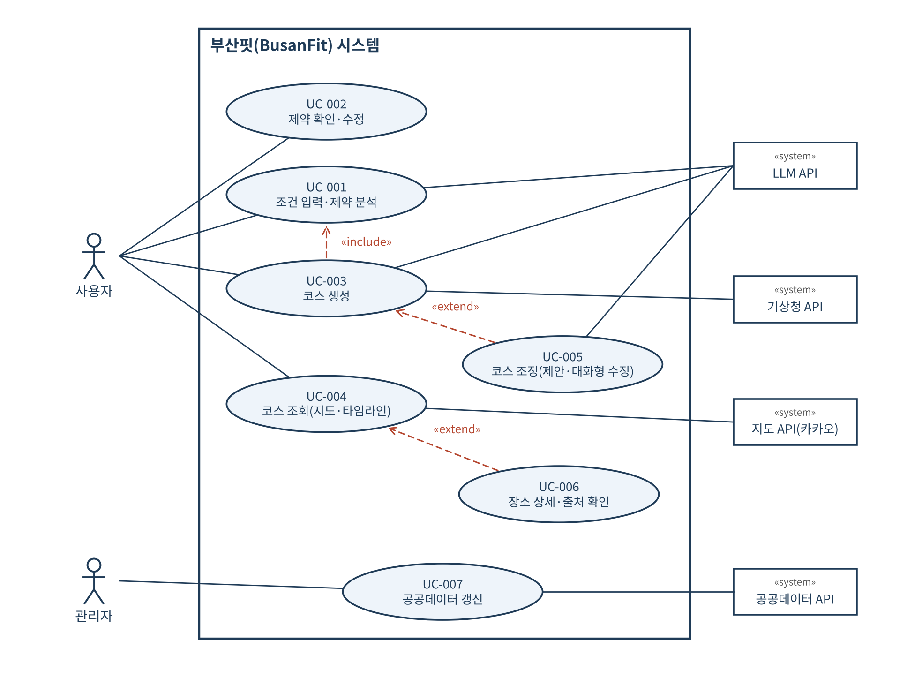
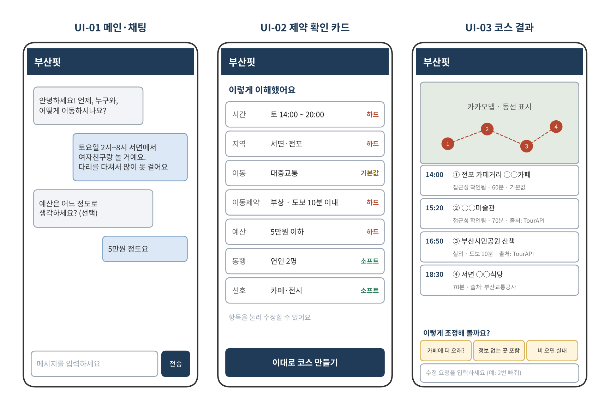

**소프트웨어 요구사항 명세서**

Software Requirements Specification (SRS)

문서 코드: SRS

| 프로젝트명 | 부산핏(BusanFit): 제약 맞춤형 부산 놀거리 코스 추천 서비스 |
|----|----|
| 팀명 | 5팀 |
| 팀원 | 김세민 / PM 이찬용 / 백엔드(데이터) 김영무 / 백엔드(AI·코스엔진) 배진호 / 프론트엔드 |
| 버전 | v0.2 |
| 작성일 | 2026-10-24 |
| 담당교수 | 임한신 교수님 |

# 문서 관리

| **버전** | **날짜** | **작성자** | **변경 내용** | **관련 결정** | **관련 PR** |
|----|----|----|----|----|----|
| 0.1 | 2026-10-24 | 김세민 | 초안 작성 (중간발표용) | \- | \- |
| 0.2 | 2026-11-09 | 김세민 | 중간발표 피드백 반영. 결정 반영: 운영 환경(SQLite, Python 3.12), FR-018 유모차 기본값·해제, AI-REQ-03 건강 정보 LLM 전달 기준, UC-001 LLM 실패 처리 | DEC-002, DEC-005, DEC-006, DEC-007, DEC-011, DEC-012 | #5 |
| 1.0 | \[예정\] |  | 최종본 |  |  |

# 1. 문서 개요 (Introduction)

## 1.1 목적 (Purpose)

본 문서는 부산 지역 공공데이터와 LLM을 활용하여, 사용자가 채팅으로 말한 제약(시간, 이동능력, 예산, 선호도, 날씨, 동행 관계)에 맞는 놀거리 코스를 생성하는 웹 서비스 "부산핏"의 소프트웨어 요구사항을 정의한다. 대상 독자는 개발 팀원(PM, 백엔드, 프론트엔드), 담당 교수 및 평가자이며, 본 문서는 설계서(SDD)와 테스트 케이스 작성의 기준으로 사용된다.

## 1.2 프로젝트 범위 (Scope)

**해결하려는 문제:** 기존 코스 추천은 일반 사용자를 가정하므로, 휠체어·유모차 이용자나 부상자, 고정 일정이 있는 사용자, 자차/대중교통·예산·동행자에 따라 조건이 다른 사용자는 추천 코스를 그대로 사용하기 어렵다. 범용 LLM은 존재하지 않거나 접근할 수 없는 장소를 추천할 위험도 있다.

**핵심 서비스:** (1) 대화형 제약 분석: 자연어 입력에서 제약 프로필을 추출하고 하드/소프트 제약으로 구분한다. (2) 제약 기반 장소 검색: 부산 공공데이터 DB에서 하드 제약을 만족하는 장소만 조회한다. (3) 맞춤 코스 생성: 시간·이동시간·체류시간을 계산해 순서와 방문 시각이 정해진 코스를 만든다. (4) 지도·동선 시각화. (5) 상호작용 코스 조정: 기본값으로 첫 코스를 보여준 뒤 조정 제안과 대화형 수정으로 맞춤화한다.

**지역 범위:** 부산 전역 데이터를 수집하되, 추천 품질 검증과 시연은 주요 권역(서면, 해운대, 광안리, 남포)에 집중한다.

**범위 제외:** 예약·결제, 회원가입·로그인, 실시간 혼잡도 및 실시간 영업 여부 보장, 영화관 상영시간표 연동(사용자가 고정 일정으로 직접 입력), 쓰레기통·휴대폰 충전소 안내(공개 데이터 미존재), 이미지 기반 질의(VLM, 향후 확장 항목으로만 기술), 부산 외 지역.

## 1.3 용어 및 약어 (Definitions & Acronyms)

| 용어/약어 | 정의 |
|----|----|
| LLM | Large Language Model. 본 시스템에서 제약 추출, 수정 의도 해석, 추천 이유 생성에 사용 |
| VLM | Vision-Language Model. 본 프로젝트 구현 범위에서는 제외하며 향후 확장(사진 기반 장소 질의)으로만 기술 |
| RAG | Retrieval-Augmented Generation. 본 시스템은 DB에서 검색한 후보 장소 정보를 LLM 입력 근거로 제공하여 설명을 생성하는 방식으로 활용 |
| 제약 프로필 | 대화에서 추출한 사용자 조건(시간, 이동수단, 이동제약, 예산, 선호도, 날씨 민감도, 동행 관계)을 항목별 값·강도·출처와 함께 구조화한 JSON 데이터 |
| 하드 제약 | 위반 시 코스가 무의미하거나 위험해지는 조건. 후보 필터로 적용하며 생성 코스는 이를 위반해서는 안 됨 (예: 휠체어 접근, 이용 시간대) |
| 소프트 제약 | 만족도에 영향을 주는 조건. 점수(가중치)로 반영 (예: 분위기, 음식 취향) |
| 앵커(고정 일정) | 사용자가 이미 확정한 일정(예: 14:00 영화). 코스 생성 시 시각을 변경하지 않음 |
| 코스 | 방문 장소의 순서, 방문 시각, 체류시간, 이동시간을 포함한 일정 |
| 접근성 등급 | 장소별 이동제약 대응 정보의 확인 상태. 확인됨 / 정보 없음 / 부적합의 3단계 |
| 기본값 | 사용자가 입력하지 않은 항목에 시스템이 적용하는 값 (예: 카페 체류 60분) |
| 조정 제안 | 첫 코스 생성 후 시스템이 사용자에게 제시하는 최대 3개의 후속 질문 칩 (예: "카페에 더 오래 있을 예정이신가요?") |
| TourAPI | 한국관광공사 관광정보 개방 서비스(Open API) |

# 2. 전체 설명 (Overall Description)

## 2.1 제품 관점 (Product Perspective)

부산핏은 독립형 웹 서비스이며, 외부 서비스와 다음과 같이 연동한다. (1) 공공데이터(한국관광공사 TourAPI, 부산교통공사·부산시설공단·공공데이터포털 데이터)는 배치 작업으로 수집하여 자체 DB에 적재한 뒤 조회한다. (2) LLM API는 제약 추출, 수정 의도 해석, 추천 이유 생성에만 사용하며 장소 선택·시간 계산은 자체 규칙 엔진이 수행한다. (3) 카카오맵 API로 지도와 동선을 표시하고, (4) 기상청 단기예보 API로 방문일 날씨를 조회한다.

## 2.2 대상 사용자 (Target Users)

| 사용자 유형 | 특징 | 주요 목표 | 권한/제약 |
|----|----|----|----|
| 일반 이용자 (관광객·데이트) | 부산 초행 또는 주말 놀거리를 찾는 사용자, 연인·친구와 방문 | 고정 일정 사이 공백 채우기, 취향에 맞는 코스 추천 | 일반 사용자 (비로그인, 세션 단위 이용) |
| 이동 제약 이용자 | 휠체어·유모차 이용자, 부상자, 고령자 | 계단·장거리 도보 없이 접근 가능한 장소 위주 코스 | 일반 사용자, 건강 관련 입력은 세션 종료 시 폐기 |
| 가족 이용자 | 영유아·어린이 동반, 자차 이동 비중 높음 | 체험·편의시설 중심 코스, 주차장 정보 | 일반 사용자 |
| 관리자 | 서비스 운영자(개발 팀) | 공공데이터 수집·갱신, 출처 관리 | 관리 권한 (서버 관리 스크립트로만 접근) |

## 2.3 운영 환경 (Operating Environment)

- Client: PC Chrome/Edge 최신 버전, 모바일 브라우저(Chrome·Safari, 화면 폭 360px 이상 반응형)

- Server: Linux / Docker, Python 3.12 + FastAPI (DEC-011)

- External AI/API: LLM API(개발 단계 Gemini Flash 계열 무료 티어, 시연 단계 Claude Haiku 5.5 또는 GPT-5 mini 중 선택), 한국관광공사 TourAPI, 공공데이터포털 API, 기상청 단기예보 API, 카카오맵 JavaScript API

- Database: SQLite (좌표는 위도·경도 숫자 컬럼, 반경 검색은 애플리케이션에서 계산, DEC-005) — Vector DB는 사용하지 않으며 확장 시 검토

## 2.4 제약사항 (Constraints)

- 부산 지역 관련 데이터의 출처 및 이용조건을 명시할 것 — 모든 장소 데이터에 제공기관·데이터명·기준일을 저장하고 화면에 표시한다.

- 개인정보 수집을 최소화할 것 — 회원가입·로그인을 두지 않으며, 부상·장애 등 건강 관련 입력은 서버 DB에 저장하지 않는다.

- LLM/VLM 단순 1회 호출만으로 구성하지 않을 것 — 제약 추출 → 필터 → 점수화 → 스케줄링 → 검증 → 설명 생성의 다단계 파이프라인으로 구성한다.

- 실제 결제/예약은 범위 밖으로 둔다.

- 무장애·가격·영업시간 정보는 공공데이터 기준이며 실제와 다를 수 있으므로, 화면에 이를 고지하고 정보가 없는 항목은 "정보 없음"으로 표시한다.

- 공공 API 호출 한도를 고려하여 장소 데이터는 배치 수집 후 DB에 캐싱하며, 카카오 API 약관에 따라 카카오 장소 데이터는 대량 저장하지 않는다.

- LLM 무료 티어는 입력이 모델 개선에 사용될 수 있으므로, 개발 중에는 가상 시나리오만 사용하고 시연 시 유료 API로 전환한다.

- API 비용은 팀 자체 부담 범위(학기 전체 수만 원 이내)로 제한한다.

- 일정 제약: 중간발표 2026-10-27(문서), 최종발표 2026년 12월 중순(구현·시연).

## 2.5 가정 및 의존성 (Assumptions & Dependencies)

외부 AI API(LLM)와 공공데이터 서비스, 카카오맵·기상청 API가 정상 제공된다고 가정한다.

공공데이터의 장소 좌표·주소는 정확하다고 가정하며, 도시철도 역간 소요시간은 부산교통공사 표준 시각을 사용한다(실제와 차이 가능).

사용자는 방문 날짜·시간대와 출발(또는 활동) 지역을 대화 중에 제공할 수 있다고 가정한다.

장소 간 이동시간은 MVP에서 직선거리 기반 보행시간 추정과 도시철도 역간 소요시간으로 계산하며, 이동제약 모드에서는 보행 속도를 낮춰 적용한다.

LLM은 지정된 JSON 스키마에 맞춰 응답할 수 있다고 가정하며, 스키마 불일치 시 재시도·대체 처리로 대응한다.

# 3. 기능 요구사항 (Functional Requirements)

| ID | 요구사항명 | 요구사항 내용 | 우선순위 | 검증 방법 | 비고 |
|----|----|----|----|----|----|
| FR-001 | 채팅 조건 입력 | 사용자는 채팅 입력창에 자연어로 일정과 조건을 입력할 수 있어야 하며, 시스템은 세션 동안 대화 이력을 유지해야 한다. | Must | Test |  |
| FR-002 | 제약 프로필 추출 | 시스템은 입력에서 시간(이용 시간대·고정 일정), 이동수단(자차·대중교통·도보), 이동제약(휠체어·유모차·부상), 예산, 선호도, 날씨 민감도, 동행 관계·인원을 추출하여 제약 프로필(JSON)로 구조화해야 한다. | Must | Test / AI Eval | AI-REQ-04 |
| FR-003 | 제약 강도 분류 | 시스템은 각 제약을 표 3-1 기준에 따라 하드/소프트로 분류해야 하며, "꼭·절대·못" 등 강한 표현이 포함된 소프트 제약은 하드로 승격해야 한다. | Must | Test / AI Eval | 표 3-1, AI-REQ-06 |
| FR-004 | 누락 정보 되묻기 | 하드 제약 판단에 필요한 정보(이용 시간대, 활동 지역)가 없으면 시스템은 코스 생성 전 최대 2개의 질문을 해야 한다. | Must | Test |  |
| FR-005 | 기본값 적용·표시 | 시스템은 미입력 항목에 기본값(체류: 카페 60분, 식사 70분, 전시·문화시설은 시설별 관람소요시간 또는 60분 / 이동수단: 대중교통 / 예산: 제한 없음)을 적용하고, 해당 항목에 '기본값' 표시를 해야 한다. | Must | Test | 그 외 카테고리(관광·야외·쇼핑·기타) 체류는 60분(설정값, TourAPI 관람소요시간 우선, DEC-018). 스프린트 2의 이동수단 기본값은 도보(DEC-001) |
| FR-006 | 제약 확인·수정 | 시스템은 추출된 제약 프로필을 카드 형태로 표시해야 하며, 사용자는 각 항목을 직접 수정한 뒤 코스 생성을 요청할 수 있어야 한다. | Must | Test | UI-02 |
| FR-007 | 제약 기반 후보 검색 | 시스템은 하드 제약(지역, 영업시간, 접근성, 예산 상한, 제외 카테고리)을 모두 만족하는 장소만 후보로 조회해야 한다. | Must | Test |  |
| FR-008 | 접근성 등급 부여 | 시스템은 각 장소에 접근성 등급(확인됨/정보 없음/부적합)을 부여해야 하며, 이동제약 모드에서는 '확인됨' 장소만 기본 후보로 사용해야 한다. | Must | Test |  |
| FR-009 | 코스 생성 | 시스템은 시간창, 체류시간, 장소 간 이동시간, 영업시간을 고려하여 장소 순서와 방문 시각이 정해진 코스를 생성해야 하며, 생성된 코스는 하드 제약을 위반해서는 안 된다. | Must | Test / AI Eval | AI-REQ-05 |
| FR-010 | 고정 일정 공백 채우기 | 사용자가 입력한 고정 일정(앵커)의 시각은 변경하지 않아야 하며, 앵커 사이 공백에는 이동시간을 제외한 가용 시간 안에 머물 수 있는 장소를 배치해야 한다. | Should | Test |  |
| FR-011 | 코스 시각화 | 시스템은 생성된 코스를 타임라인(시각·장소·체류시간)과 카카오맵 동선(번호 마커·경로선)으로 표시해야 한다. | Must | Test | UI-03 |
| FR-012 | 추천 이유·출처 표시 | 시스템은 코스의 각 장소에 1~2문장의 추천 이유와 데이터 출처(제공기관·데이터명)를 표시해야 한다. | Must | Test / Review | AI-REQ-01 |
| FR-013 | 정보 없음 장소 재생성 제안 | 이동제약 모드에서 '정보 없음'으로 제외된 장소가 있으면, 시스템은 코스 표시 후 "정보가 없는 장소도 포함해서 다시 만들어드릴까요?"를 제안해야 하며, 수락 시 해당 장소에 경고를 표시하여 코스를 재생성해야 한다. | Must | Test |  |
| FR-014 | 후속 조정 제안 | 시스템은 코스 생성 후 ① 기본값 적용 항목 ② 정보 없음으로 제외된 장소 ③ 날씨 위험 순으로 최대 3개의 조정 제안 칩을 표시해야 한다. | Must | Test | 예: "카페에 더 오래 있을 예정이신가요?" |
| FR-015 | 대화형 부분 수정 | 사용자가 조정 칩을 선택하거나 자연어로 수정을 요청하면(예: "2번 빼줘"), 시스템은 해당 장소·구간만 재계산하고 나머지 코스는 유지해야 한다. | Should | Test / AI Eval | AI-REQ-07 |
| FR-016 | 날씨 반영 | 방문일 강수확률이 60% 이상이거나 폭염·한파 특보가 있으면 시스템은 실외 장소를 후보에서 제외해야 하며, 그 외 흐림·강풍 등은 실외 장소 점수를 낮춰야 한다. | Should | Test | 임계값 조정 가능 |
| FR-017 | 편의시설 표시 | 시스템은 코스 주변 공영주차장(자차 모드, 운영시간·장애인 주차구역 여부 포함)과 도시철도 역 엘리베이터·물품보관함 위치를 표시해야 한다. | Should | Test |  |
| FR-018 | 동행 관계 반영 | 시스템은 동행 관계(연인·가족·친구·혼자)에 따라 카테고리 가중치를 다르게 적용해야 하며, 영유아 동반 가족은 유모차 접근성을 하드 제약으로 변환해야 한다. | Must | Test | 기본값(source=DEFAULT)으로 적용되며 사용자가 제약 확인 카드에서 해제할 수 있음 (DEC-002) |
| FR-019 | 코스 공유 | 사용자는 생성된 코스를 읽기 전용 링크로 공유할 수 있어야 한다(건강 관련 정보는 링크에 포함하지 않음). | Could | Test |  |
| FR-020 | 공공데이터 갱신 | 관리자는 배치 작업을 실행하여 공공데이터를 수집·정제(중복 제거, 좌표 변환)하고 DB에 갱신할 수 있어야 하며, 결과가 로그로 기록되어야 한다. | Should | Test / Review |  |

**표 3-1. 하드/소프트 제약 분류 기준 (FR-003)** — 사용자가 "꼭·절대·못" 등 강한 표현을 쓰면 소프트 제약을 하드로 승격한다.

| 제약 | 하드 제약 (필터) | 소프트 제약 (점수) | 비고 |
|----|----|----|----|
| 시간 | 이용 시간대, 고정 일정(앵커), 장소 영업시간 | 일정 여유도 선호(빡빡한/여유로운) | 영업시간 정보 없는 장소는 '정보 없음' 표시 |
| 이동수단 | 대중교통 모드: 역·정류장에서 도보 접근 가능한 장소만 | 자차 모드: 주차장 근접도 | "주차 꼭 필요" 시 하드 승격 |
| 장애요소 | 휠체어·유모차: 접근성 '확인됨'만, 엘리베이터 없는 역 경유 금지 / 부상: 최대 도보시간, 계단 회피 | 이동 횟수 최소화, 경사 적은 장소 우선 | '정보 없음'은 제외 후 재생성 제안(FR-013) |
| 예산 | 총액 상한 (가격 정보가 있는 장소에 한해 적용) | 가격대 선호(가성비/특별한 날) | 가격 정보 없음 → 추정 불가 표시 |
| 선호도 | 명시적 제외("야외 싫어", 못 먹는 음식) | 관광·체험·야외활동·음식·카페 카테고리 가중치, 분위기 |  |
| 날씨 | 강수확률 60% 이상, 폭염·한파 특보 시 실외 제외 | 흐림·강풍 시 실외 감점 | 임계값은 설정값으로 관리 |
| 동행 관계 | 영유아 동반 가족 → 유모차 접근성 하드 적용 | 연인: 분위기·야경 / 가족: 체험·편의시설 / 친구: 활동성·가성비 | 인원수는 MVP에서 소프트로만 반영 |

# 4. 비기능 요구사항 (Non-functional Requirements)

| ID | 요구사항명 | 요구사항 내용 | 우선순위 | 검증 방법 | 비고 |
|----|----|----|----|----|----|
| NFR-001 | 응답시간 | 제약 추출 응답은 5초 이내, 코스 생성(LLM 호출 포함)은 15초 이내여야 한다. (테스트 시나리오 10개 중 90% 이상 충족) | Must | Test |  |
| NFR-002 | 가용성/오류복구 | LLM 응답이 10초 내 없거나 JSON 스키마가 맞지 않으면 1회 재시도 후 규칙 기반 결과와 안내 메시지를 제공해야 하며, 공공 API 장애 시 DB에 적재된 데이터로 서비스를 계속해야 한다. | Must | Test | AI-REQ-02 |
| NFR-003 | 개인정보 보호 | 부상·장애 등 건강 관련 입력은 서버 DB에 저장하지 않고 세션 메모리에만 보관하며, 세션 종료 또는 30분 비활동 시 폐기해야 한다. 로그에는 해당 값을 마스킹해야 한다. | Must | Review / Test | AI-REQ-03 |
| NFR-004 | 브라우저 호환성 | Chrome·Edge 최신 버전과 모바일 브라우저(폭 360px 이상)에서 가로 스크롤 없이 모든 기능이 동작해야 한다. | Should | Test |  |
| NFR-005 | 로그/모니터링 | 요청별 처리시간, LLM 호출 횟수·실패 여부, 오류 내용을 로그로 기록해야 하며 민감정보는 기록하지 않아야 한다. | Should | Review |  |
| NFR-006 | 유지보수성 | LLM 제공자 교체 시 AIService 모듈 외 코드 수정 없이 설정 변경만으로 교체할 수 있어야 한다. | Must | Review / Test |  |
| NFR-007 | 사용성·접근성 | 텍스트 명도 대비 4.5:1 이상, 키보드만으로 채팅 입력과 코스 확인이 가능해야 하며, 주요 버튼·아이콘에 대체 텍스트를 제공해야 한다(WCAG 2.1 AA 기본 항목). | Should | Review |  |
| NFR-008 | 보안 | LLM·공공데이터 API 키는 환경변수 및 GitHub Secrets로 관리하고 저장소·클라이언트 코드에 노출하지 않아야 한다(카카오 JS 키는 도메인 제한 설정). | Must | Review |  |
| NFR-009 | 데이터 출처·이용조건 준수 | 모든 장소 데이터는 제공기관·데이터명·기준일·이용조건을 메타데이터로 저장하고, 화면의 장소 상세에 출처를 표시해야 한다. | Must | Review |  |

# 5. 유스케이스 (Use Cases)

## 5.1 Use Case Diagram

주 액터는 사용자와 관리자이며, 부 액터는 LLM API, 기상청 API, 지도 API(카카오), 공공데이터 API이다. 코스 생성(UC-003)은 제약 분석(UC-001)을 포함(«include»)하며, 코스 조정(UC-005)과 장소 상세·출처 확인(UC-006)은 각각 코스 생성과 코스 조회를 확장(«extend»)한다.

## 5.2 Use Case 명세

| Use Case ID | UC-001 |
|----|----|
| 이름 | 조건 입력 및 제약 분석 |
| Actor | 사용자(주), LLM API(부) |
| 사전조건 | 사용자가 메인 화면에 접속하여 세션이 생성되어 있음 |
| 트리거 | 사용자가 채팅창에 조건을 입력하고 전송 |
| 기본 흐름 | 1\. 사용자가 자연어로 조건을 입력한다(예: "토요일 2시~8시 서면, 여자친구랑, 다리를 다쳐서 많이 못 걸어요"). 2. 시스템이 입력과 대화 이력을 LLM에 전달하여 제약 프로필(JSON) 추출을 요청한다. 3. 시스템이 JSON 스키마를 검증하고 각 항목의 강도(하드/소프트)와 출처(사용자/기본값)를 설정한다. 4. 시스템이 미입력 항목에 기본값을 적용한다. 5. 시스템이 제약 확인 카드를 표시한다(UC-002). |
| 대안/예외 흐름 | 3a. 필수 정보(이용 시간대·활동 지역) 누락: 최대 2개 질문 후 1단계로 돌아간다. 2a. LLM 응답 지연(10초 초과)·3b. JSON 스키마 불일치: 1회 재시도, 재실패 시 키워드 규칙 파서로 추출한다. 파서가 확신하지 못한 항목 중 하드 제약 판단에 쓰이는 항목(지역·시간·이동제약·제외 카테고리·예산 상한)은 기본값 없이 미확인으로 두고 제약 확인 카드에서 확인을 요청하며, 소프트 항목은 기본값을 적용한다. 대체 처리 사실을 안내한다. 파서도 지역·시간을 추출하지 못하면 제약 확인 카드에 직접 입력하도록 안내한다(DEC-007). 1a. 부산 외 지역 등 범위 밖 요청: 서비스 범위를 안내한다. |
| 사후조건 | 세션 메모리에 제약 프로필이 저장됨 |
| 관련 요구사항 | FR-001, FR-002, FR-003, FR-004, FR-005, FR-018, AI-REQ-02, AI-REQ-04, AI-REQ-06 |
| 비고 | 건강 관련 정보는 세션 메모리에만 보관(NFR-003) |

| Use Case ID | UC-002 |
|----|----|
| 이름 | 제약 확인·수정 |
| Actor | 사용자 |
| 사전조건 | UC-001이 완료되어 제약 프로필이 존재함 |
| 트리거 | 시스템이 제약 확인 카드를 표시 |
| 기본 흐름 | 1\. 시스템이 항목별 값과 하드/소프트·기본값 표시를 보여준다. 2. 사용자가 값을 수정하거나(예: 이동수단을 자차로 변경) 그대로 확인한다. 3. 시스템이 제약 프로필을 갱신한다. 4. 사용자가 "이대로 코스 만들기"를 선택한다(UC-003). |
| 대안/예외 흐름 | 2a. 잘못된 값(종료 시각이 시작 시각보다 빠름 등): 입력 오류를 안내하고 재입력을 요청한다. |
| 사후조건 | 확정된 제약 프로필이 세션에 저장됨 |
| 관련 요구사항 | FR-005, FR-006 |
| 비고 | UI-02 |

| Use Case ID | UC-003 |
|----|----|
| 이름 | 코스 생성 |
| Actor | 사용자(주), 기상청 API·LLM API(부) |
| 사전조건 | 확정된 제약 프로필이 존재하고, 장소 데이터가 DB에 적재되어 있음 |
| 트리거 | 사용자가 "이대로 코스 만들기"를 선택 |
| 기본 흐름 | 1\. 시스템이 하드 제약(지역·접근성·영업시간·예산·제외 카테고리)을 만족하는 후보를 조회한다. 2. 시스템이 방문일 날씨를 조회하여 실외 장소를 제외하거나 감점한다. 3. 시스템이 소프트 제약(선호·동행 관계)으로 후보 점수를 계산한다. 4. 시스템이 시간창·체류시간·이동시간으로 장소 순서와 방문 시각을 정한다(앵커 시각 고정). 5. 시스템이 하드 제약 위반, 장소 실존 여부, 영업시간을 검증한다. 6. 시스템이 LLM으로 장소별 추천 이유를 생성하고 출처를 첨부한다. 7. 시스템이 코스를 반환한다(UC-004). |
| 대안/예외 흐름 | 1a. 후보가 2곳 미만: 검색 반경 확대 또는 소프트 제약 완화를 제안한다. 5a. 위반 발견: 해당 장소를 교체 후 재검증(최대 3회), 실패 시 가능한 구간만 표시하고 안내한다. 6a. LLM 실패: 템플릿 기반 추천 이유로 대체한다. 2a. 날씨 API 실패: "날씨 미반영"을 표시하고 진행한다. |
| 사후조건 | 생성된 코스가 세션에 저장됨 |
| 관련 요구사항 | FR-007, FR-008, FR-009, FR-010, FR-012, FR-016, FR-018, AI-REQ-01, AI-REQ-05 |
| 비고 | UC-001을 «include» |

| Use Case ID | UC-004 |
|----|----|
| 이름 | 코스 조회(지도·타임라인) |
| Actor | 사용자(주), 지도 API(부) |
| 사전조건 | UC-003으로 코스가 생성되어 있음 |
| 트리거 | 코스 생성 완료 또는 사용자가 코스 화면 진입 |
| 기본 흐름 | 1\. 시스템이 타임라인(시각·장소·체류시간·접근성 등급)을 표시한다. 2. 시스템이 카카오맵에 번호 마커와 동선을 표시한다. 3. 사용자가 편의시설(주차장·엘리베이터·보관함) 표시를 켜고 끌 수 있다. 4. 시스템이 조정 제안 칩을 표시한다(UC-005). |
| 대안/예외 흐름 | 2a. 지도 로드 실패: 지도 영역에 오류를 안내하고 타임라인만 표시한다. |
| 사후조건 | 사용자가 코스를 확인함 |
| 관련 요구사항 | FR-011, FR-017 |
| 비고 | UI-03 |

| Use Case ID | UC-005 |
|----|----|
| 이름 | 코스 조정(조정 제안·대화형 수정) |
| Actor | 사용자(주), LLM API(부) |
| 사전조건 | 코스가 화면에 표시되어 있음 |
| 트리거 | 사용자가 조정 제안 칩을 선택하거나 수정 메시지를 입력 |
| 기본 흐름 | 1\. 시스템이 최대 3개의 조정 제안 칩(기본값 항목 → 정보 없음 제외 장소 → 날씨 위험 순)을 표시한다. 2. 사용자가 칩을 선택하거나 "2번 빼고 실내로 바꿔줘"처럼 입력한다. 3. 시스템이 LLM으로 수정 의도를 변경 연산(JSON: 대상, 변경 내용)으로 변환한다. 4. 시스템이 해당 장소·구간만 재스케줄링하고 검증한다. 5. 시스템이 갱신된 코스와 변경 사항을 표시한다. |
| 대안/예외 흐름 | 2a. "정보 없는 장소 포함" 선택: 정보 없음 장소를 경고와 함께 포함하여 재생성한다. 3a. 의도 해석 불가: 수정 예시와 함께 다시 질문한다. 4a. 제약상 수정 불가: 이유를 안내하고 대안을 제시한다. |
| 사후조건 | 수정된 코스가 세션에 저장됨 |
| 관련 요구사항 | FR-013, FR-014, FR-015, AI-REQ-07 |
| 비고 | UC-003을 «extend» |

| Use Case ID | UC-006 |
|----|----|
| 이름 | 장소 상세·출처 확인 |
| Actor | 사용자 |
| 사전조건 | 코스가 화면에 표시되어 있음 |
| 트리거 | 사용자가 타임라인 또는 지도에서 장소를 선택 |
| 기본 흐름 | 1\. 시스템이 주소, 운영시간, 접근성 등급, 체류시간, 추천 이유를 표시한다. 2. 시스템이 데이터 출처(제공기관, 데이터명, 기준일, 이용조건)를 표시한다. |
| 대안/예외 흐름 | 1a. 정보가 없는 항목: "정보 없음"으로 표시한다. |
| 사후조건 | 사용자가 장소 정보와 출처를 확인함 |
| 관련 요구사항 | FR-008, FR-012, NFR-009 |
| 비고 | UC-004를 «extend», UI-04 |

| Use Case ID | UC-007 |
|----|----|
| 이름 | 공공데이터 갱신 |
| Actor | 관리자(주), 공공데이터 API(부) |
| 사전조건 | 관리자가 서버 관리 스크립트에 접근 가능 |
| 트리거 | 관리자가 배치 작업을 실행하거나 주 1회 예약 실행 |
| 기본 흐름 | 1\. 시스템이 공공데이터 API·파일데이터를 수집한다. 2. 시스템이 중복 제거, 좌표계 변환(EPSG:5174 → WGS84), 카테고리 매핑을 수행한다. 3. 시스템이 장소별 접근성 등급을 산출한다. 4. 시스템이 DB를 갱신하고 출처 메타데이터를 저장한다. 5. 시스템이 수집·실패 건수를 로그로 남긴다. |
| 대안/예외 흐름 | 1a. API 호출 한도 초과: 중단 지점을 기록하고 다음 실행에서 재개한다. 2a. 형식 오류 레코드: 제외하고 로그에 기록한다. |
| 사후조건 | DB의 장소·편의시설 데이터가 최신화됨 |
| 관련 요구사항 | FR-020, NFR-009 |
| 비고 | \- |

# 6. UI / UX 요구사항

## 6.1 주요 화면 목록

| 화면 ID | 화면명 | 목적 | 관련 요구사항 |
|----|----|----|----|
| UI-01 | 메인·채팅 화면 | 자연어 조건 입력, 되묻기 질문 응답 | FR-001, FR-004 |
| UI-02 | 제약 확인 카드 | 추출된 제약·강도·기본값 표시 및 항목 수정, 코스 생성 요청 | FR-003, FR-005, FR-006 |
| UI-03 | 코스 결과 화면 | 타임라인 + 지도 동선, 접근성 등급, 조정 제안 칩, 수정 입력 | FR-011, FR-013, FR-014, FR-015 |
| UI-04 | 장소 상세 패널 | 주소·운영시간·접근성·추천 이유·데이터 출처 표시 | FR-008, FR-012 |
| UI-05 | 편의시설 레이어 | 주차장·역 엘리베이터·물품보관함 표시 토글 | FR-017 |
| UI-06 | 코스 공유 화면 | 읽기 전용 코스 링크 조회 | FR-019 |

## 6.2 Wireframe / Mockup

핵심 화면(UI-01~03)의 저해상도 와이어프레임이다. 화면 속 장소명(○○카페 등)은 예시이며, 상세 디자인은 Figma로 구체화한다.

# 7. 데이터 요구사항 (Data Requirements)

| 데이터 ID | 데이터명 | 출처 | 형식 | 갱신/이용 조건 |
|----|----|----|----|----|
| DATA-01 | 국문 관광정보(관광지·문화시설·음식점·행사) | 한국관광공사 TourAPI (공공데이터포털) | JSON (Open API) | 주 1회 배치 수집. 출처 표시, 원본 임의 변경 금지 |
| DATA-02 | 무장애 여행 정보 | 한국관광공사 TourAPI | JSON (Open API) | 주 1회 배치 수집. 이용허락범위(공공누리 유형) 확인·준수, 출처 표시 |
| DATA-03 | 열린관광지 목록 | 한국관광공사 (공공데이터포털) | CSV | 비정기 갱신. 이용허락범위(공공누리 유형) 확인·준수, 출처 표시 |
| DATA-04 | 도시철도 역정보·엘리베이터 정보 | 부산교통공사 (공공데이터포털) | CSV / API | 갱신 시 반영. 이용허락범위(공공누리 유형) 확인·준수, 출처 표시 |
| DATA-05 | 도시철도 운행 정보(역간 소요시간) | 부산교통공사 (공공데이터포털) | CSV | 표준 시각 기준(실제와 차이 가능). 이용허락범위(공공누리 유형) 확인·준수, 출처 표시 |
| DATA-06 | 역주변 음식점 정보 | 부산교통공사 (공공데이터포털) | CSV | 갱신 시 반영. 이용허락범위(공공누리 유형) 확인·준수, 출처 표시 |
| DATA-07 | 물품보관함·자전거보관소 정보 | 부산교통공사 / 행정안전부 표준데이터 | CSV | 자전거보관소 좌표 EPSG:5174 → WGS84 변환. 이용허락범위(공공누리 유형) 확인·준수, 출처 표시 |
| DATA-08 | 주차장 정보(운영시간·요금·장애인 주차구역) | 전국주차장정보표준데이터, 부산시설공단 공영주차장 현황 | CSV / JSON | 표준데이터 월 단위 취합, 공단 API 실시간. 이용허락범위(공공누리 유형) 확인·준수, 출처 표시 |
| DATA-09 | 단기예보(강수확률·특보) | 기상청 (공공데이터포털) | JSON (Open API) | 요청 시 호출, 1시간 캐시. 이용허락범위(공공누리 유형) 확인·준수, 출처 표시 |
| DATA-10 | 지도·좌표 변환 | 카카오맵 JavaScript API | JS SDK | 카카오 이용약관 준수, 카카오 장소 데이터 대량 저장 금지 |
| DATA-11 | AI 평가 테스트셋(제약 추출 문장 30개, 코스 시나리오 10개, 수정 요청 20개) | 팀 직접 구축 | JSON | 가상 시나리오만 사용, 실제 개인정보 미포함 |

# 8. AI 관련 요구사항 (LLM/VLM)

| AI 요구 ID | 항목 | 요구사항 | 검증/평가 방법 | 비고 |
|----|----|----|----|----|
| AI-REQ-01 | 근거 기반 응답 | 코스에 포함되는 모든 장소는 DB에 존재하는 장소 ID로만 구성해야 하며, LLM은 시스템이 제공한 후보 정보 안에서만 추천 이유를 생성하고 출처를 함께 표시해야 한다. | 코스 시나리오 10개에서 DB 미존재 장소 0건 (Test Set) |  |
| AI-REQ-02 | 실패 처리 | LLM 응답 지연(10초 초과)·JSON 스키마 불일치 시 1회 재시도하고, 재실패 시 규칙 기반 결과 또는 템플릿 문장으로 대체하며 사용자에게 안내해야 한다. | System Test (장애 주입) | NFR-002 |
| AI-REQ-03 | 안전/개인정보 | 사용자가 쓴 말을 해석하는 호출(조건 추출, 수정 의도 해석)에만 사용자 원문을 전달하고, 시스템이 만든 데이터를 넘기는 호출(코스 요약, 추천 이유 생성)에는 건강 관련 정보를 범주값(예: wheelchair, stroller, injury)으로만 전달해야 한다. 원문·프롬프트·응답의 건강 정보는 로그에 저장하지 않아야 한다. 무료 티어 개발 시 가상 데이터만 사용하고, 시연은 입력을 학습에 사용하지 않는 유료 API로 진행한다. | Review / Test | NFR-003 |
| AI-REQ-04 | 제약 추출 정확도 | 제약 추출 테스트 문장 30개에서 필드 단위 정확도 85% 이상이어야 한다. | AI Evaluation (Test Set) | FR-002 |
| AI-REQ-05 | 하드 제약 위반률 | 생성된 코스의 하드 제약 위반은 0%여야 한다(자동 검증 스크립트로 확인). | AI Evaluation (자동 검사) | FR-009 |
| AI-REQ-06 | 강도 분류·되묻기 적절성 | 하드/소프트 분류 정확도 85% 이상, 필수 정보 누락 시 되묻기 발생률 100%, 한 번에 2개를 초과하는 질문 0건이어야 한다. | AI Evaluation (Test Set) | FR-003, FR-004 |
| AI-REQ-07 | 수정 의도 해석 | 수정 요청 테스트 20개에서 의도(대상·변경 내용) 해석 정확도 80% 이상이어야 한다. | AI Evaluation (Test Set) | FR-015 (Should) |

# 9. 인수 기준 (Acceptance Criteria)

| AC ID | 기준 | 관련 요구사항 | 확인 방법 |
|----|----|----|----|
| AC-001 | 사용자가 자연어 조건을 입력하면 제약 확인 카드에 추출된 항목이 표시되고 수정할 수 있음 | FR-001, FR-002, FR-006 | Acceptance Test |
| AC-002 | 이용 시간대 또는 활동 지역이 빠진 입력에 대해 코스 생성 전 2개 이하의 질문을 함 | FR-004 | Acceptance Test |
| AC-003 | 미입력 항목에 기본값이 적용되고 '기본값' 표시가 나타남 | FR-005 | Acceptance Test |
| AC-004 | 휠체어 모드 코스의 모든 장소가 접근성 '확인됨'이고 엘리베이터 없는 역을 경유하지 않음 | FR-008, FR-009 | Acceptance Test |
| AC-005 | 코스가 타임라인과 지도로 표시되고 장소마다 추천 이유와 출처가 있음 | FR-011, FR-012 | Acceptance Test |
| AC-006 | 정보 없음 장소가 제외된 경우 포함 재생성 제안이 표시되고, 수락 시 경고와 함께 재생성됨 | FR-013 | Acceptance Test |
| AC-007 | 조정 제안 칩이 3개 이하로 표시되고, 수정 시 선택한 구간 외의 장소·시각은 바뀌지 않음 | FR-014, FR-015 | Acceptance Test |
| AC-008 | 고정 일정의 시각이 코스에서 변경되지 않음 | FR-010 | Acceptance Test |
| AC-009 | 제약 추출 테스트셋 필드 정확도 85% 이상 | AI-REQ-04 | AI Evaluation |
| AC-010 | 코스 시나리오 10개에서 하드 제약 위반 0건, DB 미존재 장소 0건 | AI-REQ-01, AI-REQ-05 | AI Evaluation |
| AC-011 | 코스 생성 응답시간 15초 이내(시나리오 90% 이상) | NFR-001 | Performance Test |
| AC-012 | LLM 장애를 주입해도 대체 결과와 안내 메시지가 표시됨 | NFR-002, AI-REQ-02 | System Test |

# 10. 요구사항 추적표 (Requirements Traceability Matrix)

| 요구사항 ID | Use Case       | 설계 요소                 | Test Case | 상태  |
|-------------|----------------|---------------------------|-----------|-------|
| FR-001      | UC-001         | COMP-01, COMP-02          | TC-001    | Draft |
| FR-002      | UC-001         | COMP-03, COMP-09          | TC-002    | Draft |
| FR-003      | UC-001         | COMP-03                   | TC-003    | Draft |
| FR-004      | UC-001         | COMP-03, COMP-01          | TC-004    | Draft |
| FR-005      | UC-001, UC-002 | COMP-03, COMP-01          | TC-005    | Draft |
| FR-006      | UC-002         | COMP-01, COMP-02          | TC-006    | Draft |
| FR-007      | UC-003         | COMP-04, COMP-10          | TC-007    | Draft |
| FR-008      | UC-003, UC-006 | COMP-04, COMP-11          | TC-008    | Draft |
| FR-009      | UC-003         | COMP-05, COMP-06, COMP-07 | TC-009    | Draft |
| FR-010      | UC-003         | COMP-05                   | TC-010    | Draft |
| FR-011      | UC-004         | COMP-01                   | TC-011    | Draft |
| FR-012      | UC-003, UC-006 | COMP-08, COMP-09          | TC-012    | Draft |
| FR-013      | UC-005         | COMP-02, COMP-04          | TC-013    | Draft |
| FR-014      | UC-005         | COMP-02, COMP-01          | TC-014    | Draft |
| FR-015      | UC-005         | COMP-03, COMP-05, COMP-07 | TC-015    | Draft |
| FR-016      | UC-003         | COMP-12, COMP-04          | TC-016    | Draft |
| FR-017      | UC-004         | COMP-10, COMP-01          | TC-017    | Draft |
| FR-018      | UC-001, UC-003 | COMP-03, COMP-05          | TC-018    | Draft |
| FR-019      | \-             | COMP-01, COMP-02          | TC-019    | Draft |
| FR-020      | UC-007         | COMP-11, COMP-10          | TC-020    | Draft |
| NFR-001     | \-             | Architecture / COMP-02    | TC-021    | Draft |
| NFR-002     | \-             | COMP-09, COMP-02          | TC-022    | Draft |
| NFR-003     | \-             | COMP-02 (세션 관리)       | TC-023    | Draft |
| NFR-006     | \-             | COMP-09                   | TC-024    | Draft |
| NFR-009     | UC-006, UC-007 | COMP-10, COMP-11          | TC-025    | Draft |
| AI-REQ-01   | UC-003         | COMP-07, COMP-08          | TC-026    | Draft |
| AI-REQ-04   | UC-001         | COMP-03                   | TC-027    | Draft |
| AI-REQ-05   | UC-003         | COMP-07                   | TC-028    | Draft |

# 11. 승인 (Approval)

| 구분    | 이름                   | 확인/날짜  |
|---------|------------------------|------------|
| 팀 대표 | 김세민 (PM)            | 2026-10-24 |
| 검토자  | 이찬용, 김영무, 배진호 |            |
